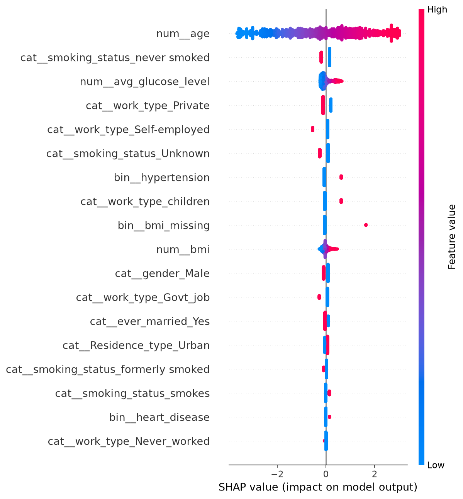

# Stroke Risk Prediction

Machine learning pipeline to estimate stroke risk from routine patient data (age, glucose, hypertension, heart disease, lifestyle), built with Python and scikit-learn.

The focus of this project is not only predictive performance but also **methodological care**: a leakage-free pipeline, evaluation suited to a rare outcome (about 5% of patients), an explicit decision threshold, model interpretation, and an honest discussion of limitations.

## Key results

Final model: logistic regression with balanced class weights, decision threshold chosen on cross-validated training predictions to reach about 80% recall. Evaluated once on a held-out test set (1,022 patients, 50 strokes).

| Metric (test set) | Value |
|---|---|
| ROC-AUC | 0.837 |
| PR-AUC (chance level = 0.049) | 0.227 |
| Recall (strokes caught) | 0.80 (40 of 50; 95% CI about 0.67 to 0.89) |
| Precision | 0.14 |
| Accuracy | 0.75 |

Confusion matrix (test set):

|  | Predicted no stroke | Predicted stroke |
|---|---|---|
| **No stroke** | 728 | 244 |
| **Stroke** | 10 | 40 |

In practical terms, the model flags about 28% of patients and catches 80% of strokes. Roughly 1 flagged patient in 7 truly has a stroke, about 2.9 times the base rate of 4.9%. Results on the test set agree with 5-fold cross-validation on the training set (recall 0.80, precision 0.14, ROC-AUC 0.85).

## Why accuracy is not used

About 95% of patients in the data have no stroke, so a model that always predicts "no stroke" reaches 95% accuracy while catching no strokes at all. The final model has lower accuracy (0.75) but detects 80% of strokes. Models are therefore compared on recall, precision, ROC-AUC and PR-AUC.

## Dataset

Kaggle "Stroke Prediction Dataset" (5,110 patients, 11 input variables, binary `stroke` target; 249 strokes). Download `healthcare-dataset-stroke-data.csv` from Kaggle and place it in `data/`. Check the dataset page for its license and citation requirements.

## Approach

1. **Data inspection and EDA** (`notebooks/01_eda.ipynb`): structure, missing values (201 missing BMI values), class imbalance, relationships between variables and stroke.
2. **Preprocessing** (`notebooks/02_modeling.ipynb`): median imputation of BMI, a "BMI missing" indicator, standardization of numeric variables, one-hot encoding of categorical variables. Everything is fitted on the training set only and wrapped in a scikit-learn `Pipeline`, so cross-validation never leaks information from validation folds.
3. **Model comparison**: dummy baseline, logistic regression, SVM and random forest, compared with stratified 5-fold cross-validation.
4. **Imbalance handling**: class weights, then selection of the decision threshold from out-of-fold predictions.
5. **Interpretation**: odds ratios and SHAP values.
6. **Robustness check**: retraining without the "BMI missing" indicator.

### Model comparison (5-fold CV on the training set)

At the default 0.5 threshold:

| Model | Accuracy | Recall | Precision | ROC-AUC | PR-AUC |
|---|---|---|---|---|---|
| Dummy (always no stroke) | 0.951 | 0.000 | 0.000 | 0.500 | 0.049 |
| Logistic regression | 0.950 | 0.020 | 0.267 | 0.853 | 0.227 |
| SVM (RBF) | 0.951 | 0.000 | 0.000 | 0.671 | 0.153 |
| Random forest | 0.951 | 0.035 | 0.486 | 0.823 | 0.187 |

With class weights ("balanced"):

| Model | Accuracy | Recall | Precision | ROC-AUC | PR-AUC |
|---|---|---|---|---|---|
| **Logistic regression** | 0.755 | 0.799 | 0.142 | 0.854 | 0.224 |
| SVM (RBF) | 0.771 | 0.644 | 0.129 | 0.810 | 0.173 |
| Random forest | 0.950 | 0.020 | 0.407 | 0.815 | 0.175 |

Observations:
- All models reach about 95% accuracy at the default threshold, including the dummy, which shows why accuracy is misleading here.
- Class weights raise recall of logistic regression from 0.02 to 0.80 without changing its ranking ability (ROC-AUC stays at 0.85).
- The SVM, which is the model used in the article that inspired this project, ranks patients less well than the linear baseline in this setting. No hyperparameter tuning was done, so this should not be read as a general statement about SVMs.
- The random forest still almost never predicts a stroke at the 0.5 threshold, even with balanced weights.
- Differences between models are modest relative to fold-to-fold variation (PR-AUC standard deviation of about 0.04), so the choice of logistic regression is also supported by its simplicity and interpretability.

## Interpretation



- **Age dominates** the model (odds ratio of about 6.3 per standard deviation, i.e. about 22.6 years). Hypertension (odds ratio about 2.0), higher glucose and heart disease also increase predicted risk, which agrees with established clinical risk factors.
- Several coefficients should **not** be over-interpreted: work type and smoking status categories overlap with age (children are mostly recorded as "Unknown" smoking status), and the positive coefficient for `work_type_children` is probably a correction for the linear age term rather than a real effect.
- SHAP and coefficients describe what the model uses, not what causes strokes.

### Robustness check: missing BMI indicator

Patients with missing BMI have a stroke rate of 19.9% versus 4.3% for the others, so the missingness is informative. This is probably a property of how the dataset was assembled and may not transfer to real clinical data. Removing the indicator changed cross-validated performance as follows:

| | ROC-AUC | PR-AUC | Recall | Precision |
|---|---|---|---|---|
| With indicator (final model) | 0.854 | 0.224 | 0.799 | 0.142 |
| Without indicator | 0.839 | 0.192 | 0.819 | 0.139 |

The drop in ranking metrics is small and within fold-to-fold variation, so the model does not depend heavily on this feature.

## Limitations

- **Small number of positive cases**: 249 strokes overall and only 50 in the test set. Test metrics have wide uncertainty (for example, recall of 40/50 has a 95% confidence interval of about 0.67 to 0.89).
- **Single public dataset** of unclear provenance, with no external validation. Performance in a real clinical population is unknown.
- **Data artifacts**: the informative missing-BMI pattern and the "Unknown" smoking category (mostly children) reflect how the data was collected.
- **Low precision**: with a 5% prevalence, even an 80%-recall model produces many false alarms. Whether this trade-off is acceptable is a clinical decision.
- **No hyperparameter tuning** and only simple models. Age and glucose enter the logistic regression linearly, although glucose is bimodal.


## Repository structure

```
stroke-prediction/
├── data/              # dataset (from Kaggle)
├── notebooks/
│   ├── 01_eda.ipynb          # inspection and exploratory analysis
│   └── 02_modeling.ipynb     # preprocessing, models, evaluation, SHAP
├── figures/           # saved plots used in this README
├── src/               # reserved for reusable code
├── requirements.txt
└── README.md
```

## How to run

```bash
git clone https://github.com/intissarmegtouf/stroke-prediction.git
cd stroke-prediction
python -m venv .venv
source .venv/bin/activate        # Windows: .venv\Scripts\activate
pip install -r requirements.txt
jupyter lab
```

Run `notebooks/01_eda.ipynb`, then `notebooks/02_modeling.ipynb`.

## Tools

Python, pandas, NumPy, scikit-learn, imbalanced-learn, SHAP, matplotlib, seaborn, JupyterLab.